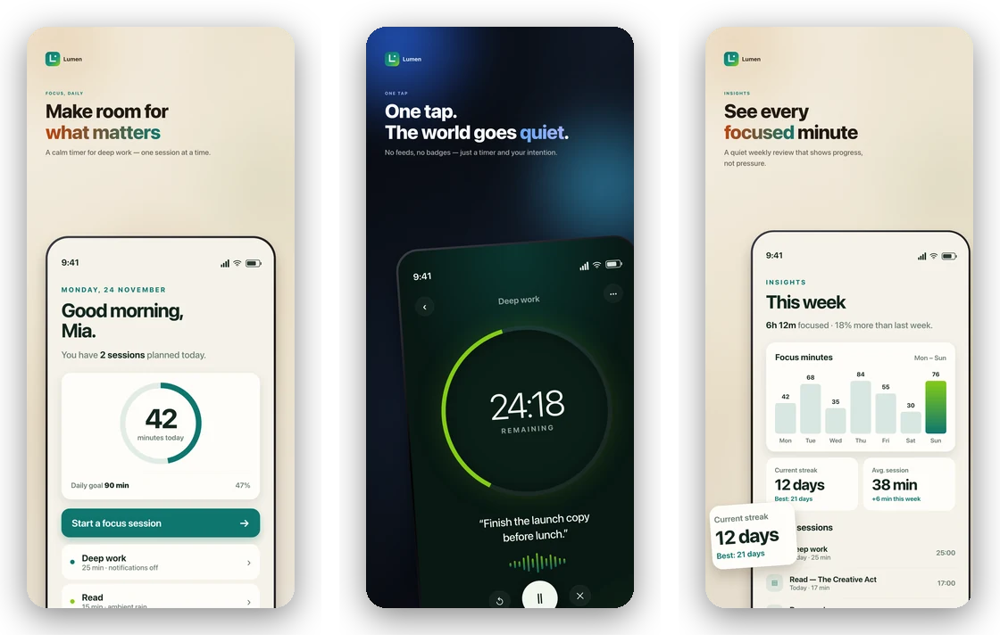
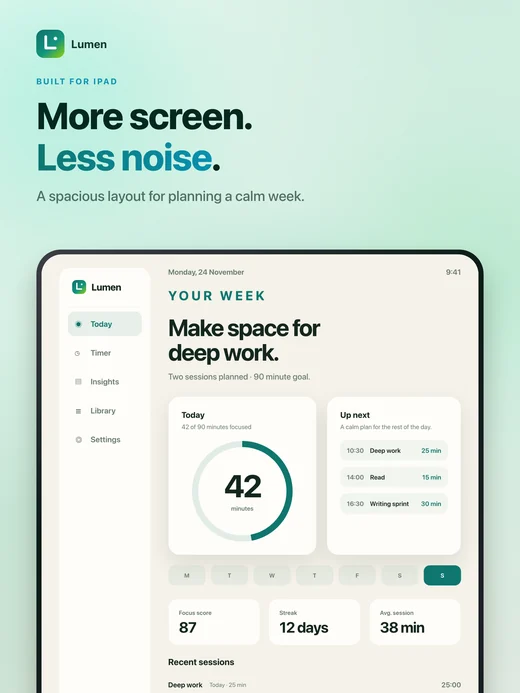
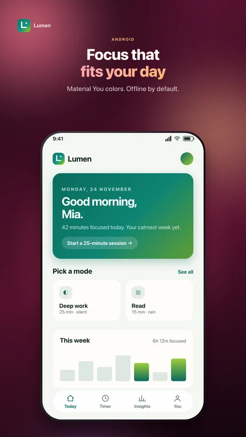
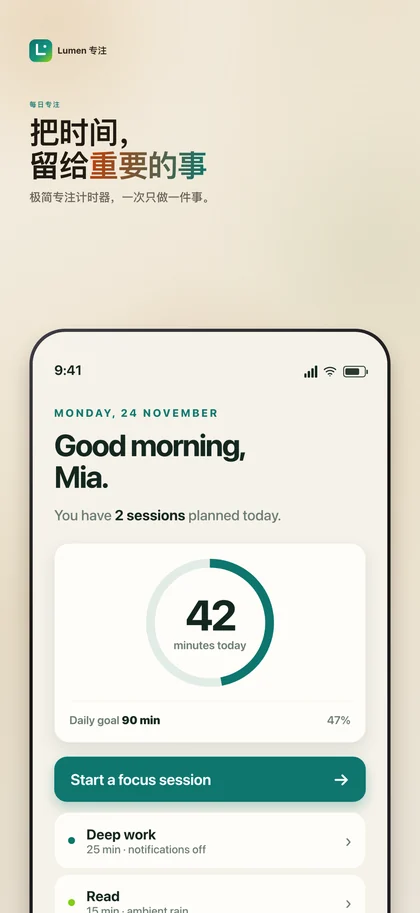

# Store Screenshots

**Pixel-perfect App Store, Google Play and AppGallery listing screenshots from real app captures.**

[English](README.md) · [简体中文](README.zh-CN.md)

[](https://github.com/matthewlu070111/store-screenshots-skill/actions/workflows/ci.yml)
[](LICENSE)
[](https://nodejs.org)
[](package.json)



<sub>Demo artwork is synthetic and bundled with the repo. It is not a real product; use your own captures.</sub>

Store consoles reject the wrong dimensions, transparent pixels and oversized files. This tool turns raw simulator/device captures into upload-ready listing images **locally**, with the exact pixel size required by each platform. No design file, no cloud service, no runtime dependencies.

## Why

- **Exact pixels, not “close enough”.** Headless Chrome renders at a fixed viewport, then the output is measured again. A 1206×2622 slot is 1206×2622, not 1205×2622.
- **RGB PNGs only.** App Store Connect rejects alpha channels; the renderer always produces opaque PNGs.
- **One source, every platform.** iPhone 6.3"/6.9", iPhone Duo, iPad 13", Google Play phone/tablet and AppGallery phone/tablet from one config.
- **Localizable.** Write copy once as `{ "zh-CN": "…", "en-US": "…" }`; output goes to per-locale folders.
- **Auditable.** `manifest.json` records dimensions, byte size and SHA-256 for every output, and `--verify` re-checks it.

## Features

- **20 presets** for App Store (including iPhone Duo and App Preview poster sizes), Google Play and AppGallery, plus arbitrary `[width, height]`.
- **4 layouts**: `hero`, `split`, `minimal`, `detail` (a close-up inset).
- **8 themes**: aurora, midnight, sunset, ocean, mono, paper, mint, lilac; override any color.
- **Brand controls**: logo, app name, eyebrow, subtitle, badge, background image, device frame.
- **Localization**: locale maps with `default` fallback; automatic RTL for Arabic, Hebrew, Persian and Urdu.
- **Incremental runs**: `--only iphone` / `--locale zh-CN` regenerate one group and merge the existing manifest.
- **Built-in checks**: `--dry-run`, `--doctor`, `--verify`, file-size warnings and orientation warnings.
- **Self-contained output**: `manifest.json`, `preview.html`, and the PNGs.

## Quick start

Requirements: **Node 18.17+** and an installed **Chrome / Chromium / Edge / Brave / Arc**. Nothing else — there is no `npm install` step.

```bash
git clone https://github.com/matthewlu070111/store-screenshots-skill.git
cd store-screenshots-skill

npm run doctor     # checks Node, browser, presets and does a test render
npm run demo       # generates the bundled demo into examples/demo/out
npm run verify -- examples/demo/out
```

Open `examples/demo/out/preview.html` to review the result. To generate your own:

```bash
node scripts/generate.mjs ./my-app.config.json --dry-run
node scripts/generate.mjs ./my-app.config.json
node scripts/generate.mjs --verify ./store-shots
```

Or install the CLI globally from a checkout:

```bash
npm link
store-screenshots ./my-app.config.json
```

## Gallery

All images below were generated from the bundled demo config. They intentionally show different platforms, themes and locales.

| iPad 13" · mint | Google Play · sunset | 中文 · paper |
| --- | --- | --- |
|  |  |  |

## Usage

1. **Capture real screens.** Use simulator or device screenshots (PNG/JPEG/WebP). At least 3 for a story; do not upscale low-resolution images.
2. **Write the config.** One set per device size; one shot per screen. Relative paths resolve from the config file.
3. **Dry-run first.** It validates every image path, preset, locale and layout without rendering.
4. **Generate.** Each render is written to the output directory; a manifest and preview page are rebuilt.
5. **Inspect every image.** Open each PNG in your image viewer and check titles, line breaks, crops and contrast.
6. **Verify before upload.** `--verify` checks dimensions, alpha, size limits and manifest hashes.

Minimal config:

```json
{
  "$schema": "./schema/config.schema.json",
  "app": { "default": "Pomo", "zh-CN": "番茄专注", "en-US": "Pomo Focus" },
  "outDir": "./store-shots",
  "locales": ["zh-CN", "en-US"],
  "theme": "aurora",
  "sets": [
    {
      "name": "iphone-6.3",
      "device": "iphone-6.3",
      "shots": [
        {
          "image": "./captures/home.png",
          "eyebrow": { "zh-CN": "专注计时", "en-US": "FOCUS TIMER" },
          "title": {
            "zh-CN": "把注意力\n留给{重要的事}",
            "en-US": "Give your focus\nto what {matters}"
          },
          "subtitle": {
            "zh-CN": "极简番茄钟，把清醒的时间留给重要的事。",
            "en-US": "A minimal Pomodoro timer for the work that matters."
          }
        }
      ]
    }
  ]
}
```

Copy [`examples/template.config.json`](examples/template.config.json) for a multi-platform starting point. The full field reference lives in [`references/config-reference.md`](references/config-reference.md); the JSON Schema powers editor autocomplete: [`schema/config.schema.json`](schema/config.schema.json).

### Copy syntax

- `{text}` renders in the theme's gradient accent color.
- `\n` forces a line break.
- A string is shared by every locale; an object is resolved per locale with `default` → first value fallback.
- Precedence is **shot → set → top level** for styling and copy fields.
- With `locales`, files go to `<outDir>/<locale>/`; without it, directly to `<outDir>/`.

## CLI

| Option | Description |
| --- | --- |
| `--out <dir>` | Override `outDir` (relative to CWD) |
| `--only <text>` | Generate only sets whose name/device/preset contains the text |
| `--locale <tag>` | Generate only that locale |
| `--dry-run` | Validate and print the plan; write nothing |
| `--keep-html` | Keep per-shot HTML in `<out>/.debug-html` |
| `--quiet` | Suppress warnings |
| `--doctor` | Check Node, browser, presets and do a 320×480 test render |
| `--list-presets` | List all 20 presets |
| `--verify <dir>` | Re-check a generated output directory |
| `--version`, `--help` | Version and usage |

Environment variables:

| Variable | Purpose |
| --- | --- |
| `CHROME_PATH` | Explicit Chromium-based browser executable |
| `CHROME_NO_SANDBOX=1` | Adds `--no-sandbox`; only for trusted containers running as root |
| `DEBUG=1` | Print stack traces on failure |

## Presets

| Preset | Size (portrait) | Store | Notes |
| --- | --- | --- | --- |
| `iphone-6.9` | 1320×2868 | App Store | Recommended high-resolution hero size |
| `iphone-6.3` | 1206×2622 | App Store | Required iPhone size in the 2026 spec |
| `iphone-6.5` | 1242×2688 | App Store | Optional legacy fallback |
| `iphone-5.5` | 1242×2208 | App Store | Legacy 5.5" coverage |
| `iphone-duo-outer` | 1398×2034 | App Store | iPhone Duo outer display |
| `iphone-duo-inner` | 2007×2853 | App Store | iPhone Duo inner display with a subtle crease |
| `iphone-duo-preview` | 886×1920 | App Store | App Preview **poster**; the video slot still needs a real .mp4/.mov |
| `ipad-13` | 2064×2752 | App Store | Required when the app supports iPad |
| `ipad-11` | 1668×2420 | App Store | Optional iPad 11" coverage |
| `play-phone` | 1080×1920 | Google Play | 2–8 screenshots per device type |
| `play-tablet` | 1600×2560 | Google Play | 10" tablet |
| `harmony-phone` | 1080×1920 | AppGallery | 3–5 screenshots, ≤5 MB typical |
| `harmony-tablet` | 1600×2560 | AppGallery | Portrait tablet |

Add `"orientation": "landscape"` to a preset-based set to swap width and height (custom `size` values are used exactly as written). Run `npm run presets` for the complete list, including alternative sizes and App Preview posters.

> Store requirements change. Sizes in this repo were reviewed in **November 2026**; confirm the current rules in App Store Connect, Play Console and AGC before submitting.

## Output

```text
store-shots/
├── zh-CN/
│   ├── iphone-6-3-01.png
│   ├── iphone-6-3-02.png
│   └── …
├── en-US/
│   └── …
├── manifest.json
└── preview.html
```

`manifest.json` includes the app name, generator version, per-set store/device/locale, limits, and for every file: relative path, title, width, height, bytes, SHA-256, source filename and source SHA-256. `preview.html` is a local thumbnail gallery.

## How it works

1. Normalize the config, resolve locale maps and merge shot/set/top-level defaults.
2. Read each source image header (PNG/JPEG/WebP/SVG) for dimensions and alpha; embed it as a data URL.
3. Render [`templates/poster.html`](templates/poster.html) in headless Chrome with `--force-device-scale-factor=1`, sRGB, and an exact `--window-size`.
4. Re-read the output PNG, assert the exact dimensions, warn on file-size limits, and record SHA-256.
5. Rebuild `manifest.json` and `preview.html`; `--verify` repeats the checks later.

Everything is local: no uploads, no network requests, no AI generation. Temporary HTML files are deleted after rendering; your source captures are never modified.

## Project structure

```text
store-screenshots-skill/
├── SKILL.md                  # agent-facing workflow (this repo is also a skill)
├── README.md                 # English docs
├── README.zh-CN.md           # 中文文档
├── package.json              # CLI metadata; zero runtime dependencies
├── presets.json              # platform size presets
├── themes.json               # color themes
├── schema/config.schema.json # JSON Schema for editor autocomplete
├── scripts/
│   ├── generate.mjs          # CLI entry point
│   ├── build-demo-assets.mjs # rebuild synthetic demo sources
│   ├── check.mjs             # repo hygiene checks
│   └── test.mjs              # cross-platform test discovery
├── src/                      # CLI, config, rendering, verification modules
├── templates/poster.html     # layout/theme/device-frame template
├── references/               # platform specs, config reference, design guide
├── examples/
│   ├── demo/                 # runnable synthetic demo + sources
│   └── template.config.json  # copy-and-edit starting point
├── test/                     # unit + integration tests (node:test)
└── docs/images/              # README/social images
```

## Development

```bash
npm run check                 # JSON, required files, package metadata, syntax
npm test                      # unit + integration
npm run test:unit
npm run test:integration      # renders one 320×480 image; skipped without a browser
npm run build:demo-assets     # re-render examples/demo/source → assets/screens
```

The test suite uses only `node:test` and `node:assert`; there are no dev dependencies. CI runs on Node 18/20/22/24, then generates and verifies the full 12-image demo on Linux with Chrome.

See [`CONTRIBUTING.md`](CONTRIBUTING.md) before opening a PR, and [`docs/architecture.md`](docs/architecture.md) for the module map.

## Programmatic API

```js
import { generate, verify, buildPlan } from 'store-screenshots';

const plan = buildPlan({
  cfg: { sets: [{ device: 'iphone-6.3', shots: [{ image: './home.png' }] }] },
  baseDir: process.cwd(),
  outDir: './out',
});

await generate({ configPath: './store-shots.config.json' });
const { errors } = verify('./store-shots');
```

The package exports `generate`, `buildPlan`, `verify`, `buildPreview`, `findBrowser`, `renderPng`, `imageInfo`, config helpers, `PRESETS`, `THEMES` and `VERSION`.

## Using it as an agent skill

The repository root is a skill: [`SKILL.md`](SKILL.md) contains the design workflow, platform checklist and troubleshooting table. Install it by copying this directory into your agent's skills folder, for example:

```bash
cp -R store-screenshots-skill ~/.config/opencode/skills/store-screenshots
```

The CLI is the same whether you use it directly or through an agent.

## Limitations

- This is a **layout tool**, not an AI image generator. Screenshot content must come from a real product.
- It does not fabricate ratings, download counts, awards, media logos, system UI or platform endorsements.
- **App Preview is video.** `iphone-duo-preview` produces a still poster/first frame only, not an uploadable video.
- Device frames are generic CSS shapes; no Apple/Huawei copyrighted product renders are bundled.
- Store specifications change. The size table was updated **2026-11**; check the official docs before a submission.
- The project was inspired by [NimoteShot](https://github.com/mobiledevloperlab/nimoteshot)'s workflow (real captures, local rendering, localization, size validation); NimoteShot is AGPL-3.0-or-later. The implementation here is independent; no AGPL code was copied.

## Contributing

Issues and PRs are welcome. Please read [`CONTRIBUTING.md`](CONTRIBUTING.md), follow the [Code of Conduct](CODE_OF_CONDUCT.md), and report security issues privately per [`SECURITY.md`](SECURITY.md). Never commit a real user's screenshots or credentials.

## License

[MIT](LICENSE) © 2026 Matthew Lu and contributors.
