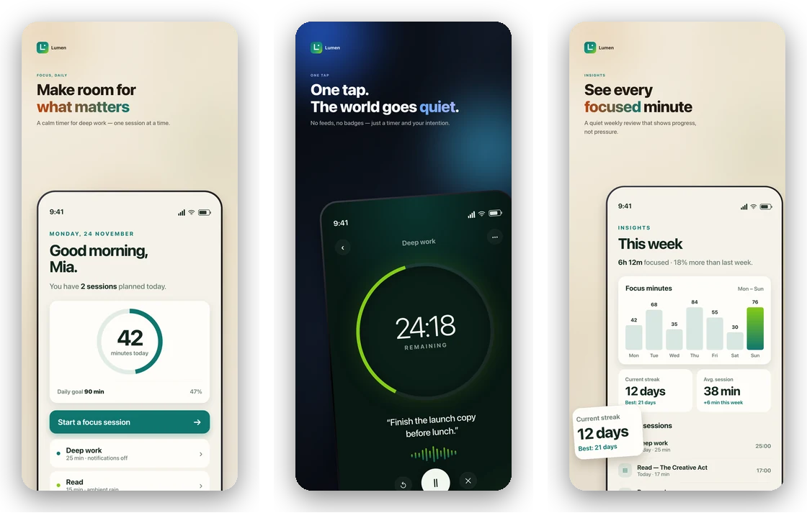
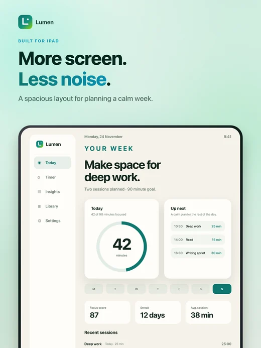
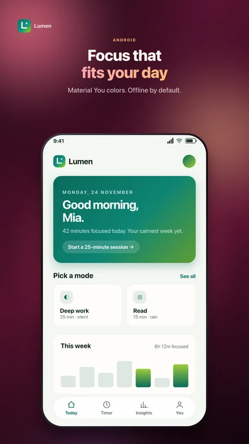
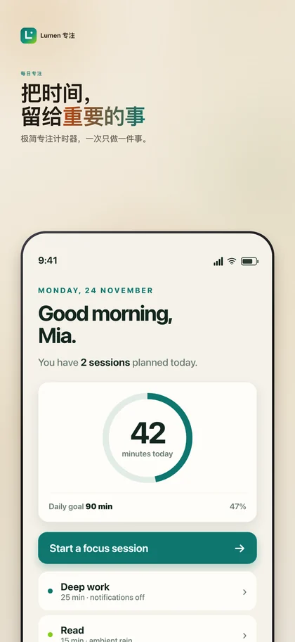

# Store Screenshots

**从真实 App 截图生成可直接上传的 App Store / Google Play / AppGallery 商店图。**

[English](README.md) · [简体中文](README.zh-CN.md)

[](https://github.com/matthewlu070111/store-screenshots-skill/actions/workflows/ci.yml)
[](LICENSE)
[](https://nodejs.org)
[](package.json)



<sub>演示图为仓库内置的合成素材，不是真实产品；请使用你自己的截图。</sub>

商店后台会因为尺寸不对、带 alpha 透明通道或文件过大而拒图。这个工具在**本地**把模拟器/真机截图排版成精确尺寸的上架素材：不需要 Figma、不上传云端、也没有任何运行时依赖。

## 为什么

- **精确像素，而不是“差不多”。** 无头 Chrome 在固定视口渲染，生成后再次测量输出。1206×2622 的槽位就是 1206×2622。
- **只输出 RGB PNG。** App Store Connect 不接受 alpha 通道，渲染器始终输出不透明 PNG。
- **一套配置，多平台。** iPhone 6.3"/6.9"、iPhone Duo、iPad 13"、Google Play 手机/平板、AppGallery 手机/平板。
- **多语言。** 文案写成 `{ "zh-CN": "…", "en-US": "…" }`，按语言输出到独立目录。
- **可审计。** `manifest.json` 记录每张图的尺寸、字节数和 SHA-256，`--verify` 可随时复检。

## 特性

- **20 个预设**：覆盖 App Store（含 iPhone Duo、App Preview 海报尺寸）、Google Play、AppGallery，也支持任意 `[width, height]`。
- **4 种版式**：`hero`、`split`、`minimal`、`detail`（左下角特写卡片）。
- **8 套主题**：aurora、midnight、sunset、ocean、mono、paper、mint、lilac，任意颜色可覆盖。
- **品牌控制**：logo、App 名称、eyebrow、副标题、徽章、背景图、设备框。
- **本地化**：语言对象支持 `default` 回退；阿拉伯语/希伯来语/波斯语/乌尔都语自动 RTL。
- **增量生成**：`--only iphone` / `--locale zh-CN` 只重跑一组，并与已有 manifest 合并。
- **内置检查**：`--dry-run`、`--doctor`、`--verify`、文件大小与方向警告。
- **完整输出**：`manifest.json`、`preview.html` 和全部 PNG。

## 快速开始

环境要求：**Node 18.17+**，以及已安装的 **Chrome / Chromium / Edge / Brave / Arc**。不需要 `npm install`。

```bash
git clone https://github.com/matthewlu070111/store-screenshots-skill.git
cd store-screenshots-skill

npm run doctor     # 检查 Node、浏览器、预设，并做一次测试渲染
npm run demo       # 生成内置演示到 examples/demo/out
npm run verify -- examples/demo/out
```

打开 `examples/demo/out/preview.html` 查看结果。生成自己的素材：

```bash
node scripts/generate.mjs ./my-app.config.json --dry-run
node scripts/generate.mjs ./my-app.config.json
node scripts/generate.mjs --verify ./store-shots
```

也可以从本地 checkout 安装 CLI：

```bash
npm link
store-screenshots ./my-app.config.json
```

## 示例

以下图片全部由仓库内的演示配置生成，故意展示不同平台、主题和语言。

| iPad 13" · mint | Google Play · sunset | 中文 · paper |
| --- | --- | --- |
|  |  |  |

## 使用流程

1. **收集真实截图。** 用模拟器/真机原始截图（PNG/JPEG/WebP），至少 3 张讲一个完整故事；低清图不要放大。
2. **写配置。** 每个设备尺寸一个 set，每张截图一个 shot。相对路径相对于配置文件所在目录。
3. **先 dry-run。** 校验所有图片路径、预设、语言和版式，不渲染。
4. **生成。** 每次渲染写入输出目录，同时重建 manifest 和预览页。
5. **逐张检查。** 用图片查看器检查标题换行、设备裁切、对比度、缩略图可读性。
6. **上传前 verify。** `--verify` 检查尺寸、alpha、文件大小上限和 manifest 哈希。

最小配置：

```json
{
  "$schema": "./schema/config.schema.json",
  "app": { "default": "Pomo", "zh-CN": "番茄专注", "en-US": "Pomo Focus" },
  "outDir": "./store-shots",
  "locales": ["zh-CN", "en-US"],
  "theme": "aurora",
  "sets": [
    {
      "name": "iphone-6.3",
      "device": "iphone-6.3",
      "shots": [
        {
          "image": "./captures/home.png",
          "eyebrow": { "zh-CN": "专注计时", "en-US": "FOCUS TIMER" },
          "title": {
            "zh-CN": "把注意力\n留给{重要的事}",
            "en-US": "Give your focus\nto what {matters}"
          },
          "subtitle": {
            "zh-CN": "极简番茄钟，把清醒的时间留给重要的事。",
            "en-US": "A minimal Pomodoro timer for the work that matters."
          }
        }
      ]
    }
  ]
}
```

多平台起步配置见 [`examples/template.config.json`](examples/template.config.json)。完整字段见 [`references/config-reference.md`](references/config-reference.md)，JSON Schema 可为编辑器提供补全：[`schema/config.schema.json`](schema/config.schema.json)。

### 文案语法

- `{文字}` 渲染成主题渐变强调色。
- `\n` 强制换行。
- 字符串由所有语言共用；对象按当前语言取值，回退顺序为 `default` → 第一个值。
- 样式和文案字段优先级：**shot → set → 顶层**。
- 配置了 `locales` 时输出到 `<outDir>/<locale>/`；否则直接输出到 `<outDir>/`。

## CLI

| 选项 | 说明 |
| --- | --- |
| `--out <dir>` | 覆盖 `outDir`（相对当前工作目录） |
| `--only <text>` | 只生成 name/device/preset 包含该文本的组 |
| `--locale <tag>` | 只生成指定语言 |
| `--dry-run` | 校验并打印计划，不写文件 |
| `--keep-html` | 保留每张图的 HTML 到 `<out>/.debug-html` |
| `--quiet` | 关闭警告 |
| `--doctor` | 检查 Node、浏览器、预设，并做 320×480 测试渲染 |
| `--list-presets` | 列出全部 20 个预设 |
| `--verify <dir>` | 复检输出目录 |
| `--version` / `--help` | 版本与用法 |

环境变量：

| 变量 | 用途 |
| --- | --- |
| `CHROME_PATH` | 指定 Chromium 系浏览器可执行文件 |
| `CHROME_NO_SANDBOX=1` | 追加 `--no-sandbox`；仅用于以 root 运行的受信任容器 |
| `DEBUG=1` | 失败时打印堆栈 |

## 预设

| 预设 | 竖屏尺寸 | 商店 | 说明 |
| --- | --- | --- | --- |
| `iphone-6.9` | 1320×2868 | App Store | 推荐的高清主图尺寸 |
| `iphone-6.3` | 1206×2622 | App Store | 2026 规范中的 iPhone 必填尺寸 |
| `iphone-6.5` | 1242×2688 | App Store | 可选旧尺寸兜底 |
| `iphone-5.5` | 1242×2208 | App Store | 旧款 5.5" 覆盖 |
| `iphone-duo-outer` | 1398×2034 | App Store | iPhone Duo 外屏 |
| `iphone-duo-inner` | 2007×2853 | App Store | iPhone Duo 内屏，带轻微折痕 |
| `iphone-duo-preview` | 886×1920 | App Store | App Preview **首帧海报**；视频槽位仍需真实 .mp4/.mov |
| `ipad-13` | 2064×2752 | App Store | App 支持 iPad 时必填 |
| `ipad-11` | 1668×2420 | App Store | 可选 iPad 11" 覆盖 |
| `play-phone` | 1080×1920 | Google Play | 每种设备 2–8 张 |
| `play-tablet` | 1600×2560 | Google Play | 10" 平板 |
| `harmony-phone` | 1080×1920 | AppGallery | 常见 3–5 张，≤5 MB |
| `harmony-tablet` | 1600×2560 | AppGallery | 竖屏平板 |

在基于预设的 set 里加 `"orientation": "landscape"` 会自动交换宽高；自定义 `size` 按原样使用。运行 `npm run presets` 查看完整列表（包含替代尺寸和 App Preview 海报）。

> 商店规范会变化。本仓库尺寸表更新于 **2026-11**；提交前请在 App Store Connect、Play Console 和 AGC 核对当前要求。

## 输出

```text
store-shots/
├── zh-CN/
│   ├── iphone-6-3-01.png
│   ├── iphone-6-3-02.png
│   └── …
├── en-US/
│   └── …
├── manifest.json
└── preview.html
```

`manifest.json` 包含 App 名称、生成器版本、每组 set 的商店/设备/语言/限制，以及每个文件的相对路径、标题、宽高、字节数、SHA-256、源图文件名和源图 SHA-256。`preview.html` 是本地缩略图预览页。

## 工作原理

1. 规范化配置，解析语言对象，合并 shot/set/顶层默认值。
2. 读取源图文件头（PNG/JPEG/WebP/SVG）获取尺寸和 alpha，并以内联 data URL 嵌入。
3. 用无头 Chrome 渲染 [`templates/poster.html`](templates/poster.html)，固定 `--force-device-scale-factor=1`、sRGB 和精确 `--window-size`。
4. 重新读取输出 PNG，断言尺寸精确，检查文件大小上限，记录 SHA-256。
5. 重建 `manifest.json` 和 `preview.html`；`--verify` 可随时重复检查。

全程本地：不上传、不联网、不调用 AI。源图会被嵌入临时 HTML，渲染后临时文件删除；原始截图不会被修改。

## 项目结构

```text
store-screenshots-skill/
├── SKILL.md                  # Agent 工作流（本仓库同时是一个 skill）
├── README.md                 # 英文文档
├── README.zh-CN.md           # 中文文档
├── package.json              # CLI 元数据；零运行时依赖
├── presets.json              # 平台尺寸预设
├── themes.json               # 颜色主题
├── schema/config.schema.json # 编辑器补全用 JSON Schema
├── scripts/
│   ├── generate.mjs          # CLI 入口
│   ├── build-demo-assets.mjs # 重建合成演示素材
│   ├── check.mjs             # 仓库卫生检查
│   └── test.mjs              # 跨平台测试发现
├── src/                      # CLI、配置、渲染、校验模块
├── templates/poster.html     # 版式/主题/设备框模板
├── references/               # 平台规格、配置参考、设计指南
├── examples/
│   ├── demo/                 # 可运行的合成演示 + 源文件
│   └── template.config.json  # 复制后修改的起点
├── test/                     # 单元 + 集成测试（node:test）
└── docs/images/              # README/社交预览图
```

## 开发

```bash
npm run check                 # JSON、必需文件、包元数据、语法
npm test                      # 单元 + 集成
npm run test:unit
npm run test:integration      # 渲染一张 320×480；没有浏览器时跳过
npm run build:demo-assets     # 重新渲染 examples/demo/source → assets/screens
```

测试只用 `node:test` 和 `node:assert`，没有开发依赖。CI 在 Node 18/20/22/24 上运行，并在 Linux + Chrome 上生成并校验完整的 12 张演示图。

提交 PR 前请阅读 [`CONTRIBUTING.md`](CONTRIBUTING.md)；模块结构见 [`docs/architecture.md`](docs/architecture.md)。

## 编程 API

```js
import { generate, verify, buildPlan } from 'store-screenshots';

const plan = buildPlan({
  cfg: { sets: [{ device: 'iphone-6.3', shots: [{ image: './home.png' }] }] },
  baseDir: process.cwd(),
  outDir: './out',
});

await generate({ configPath: './store-shots.config.json' });
const { errors } = verify('./store-shots');
```

包导出 `generate`、`buildPlan`、`verify`、`buildPreview`、`findBrowser`、`renderPng`、`imageInfo`、配置工具函数、`PRESETS`、`THEMES` 和 `VERSION`。

## 作为 Agent Skill 使用

仓库根目录就是 skill：[`SKILL.md`](SKILL.md) 包含设计流程、平台自查表和排错表。把整个目录复制到 Agent 的 skills 目录即可，例如：

```bash
cp -R store-screenshots-skill ~/.config/opencode/skills/store-screenshots
```

无论直接用 CLI 还是通过 Agent 调用，生成器完全相同。

## 限制

- 这是**排版工具**，不是 AI 生图工具；截图内容必须来自真实产品。
- 不伪造评分、下载量、奖项、媒体 Logo、系统 UI 或平台背书。
- **App Preview 是视频。** `iphone-duo-preview` 只生成静帧海报/首帧，不能直接上传到视频槽位。
- 设备框是通用 CSS 造型，不内置 Apple/华为受版权保护的产品渲染图。
- 商店规范会更新。尺寸表更新于 **2026-11**，提交前仍应核对官方文档。
- 设计流程参考了 [NimoteShot](https://github.com/mobiledevloperlab/nimoteshot)（AGPL-3.0-or-later）的思路（真实截图、本地渲染、多语言、尺寸校验），代码为独立实现，未复制 AGPL 代码。

## 贡献

欢迎 Issue 和 PR。请先阅读 [`CONTRIBUTING.md`](CONTRIBUTING.md)，遵守 [行为准则](CODE_OF_CONDUCT.md)；安全问题请按 [`SECURITY.md`](SECURITY.md) 私下报告。不要提交真实用户截图或凭据。

## 许可证

[MIT](LICENSE) © 2026 Matthew Lu 及贡献者。
